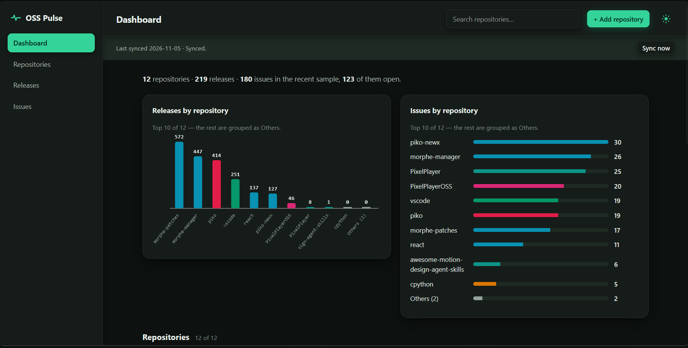
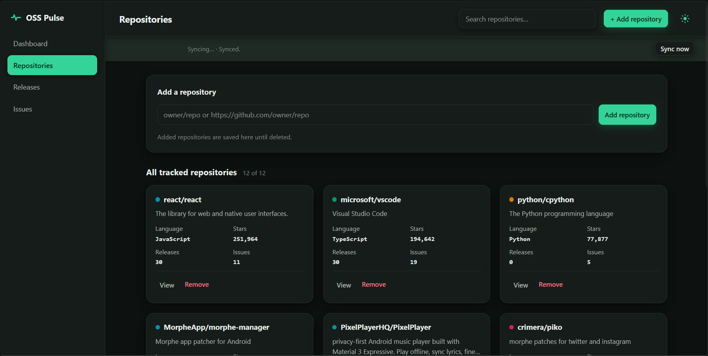

# OSS Pulse

A Flask dashboard that compares release activity and issue health across open-source projects on GitHub.

OSS Pulse pulls repository, release and issue data from the GitHub REST API, validates it with Pydantic, cleans it with pandas, stores it in SQLite, and turns it into a dashboard — trends over time, open vs. closed issues, and per-repo insights computed from each repo's own data, never written by hand.


---

## 🌟 Features

- **📊 Compare Projects**
  Compare tracked repos on stars, forks, release activity and issue health, side by side.
- **🚀 Release Tracking**
  Latest releases  with Dev/Stable pills, release totals, and average gap between releases.
- **🐛 Issue Health**
  Open vs. closed counts, monthly activity, and average resolution time from closed issues in the sample.
- **🔍 Page-wise Search**
  Search on each page filters that page — Issues by repo or title, Releases by repo or tag, Repositories by name.
- **➕ Add Any Public Repo**
  Add a repo from the Repositories page as `owner/repo` or a full GitHub URL, delete it from its card or detail page. Added repos persist in the database and `repos.txt`.
- **🔄 Daily Autosync**
  Data refreshes on open when the last run is over 24 hours old. Press Sync now for a manual refresh, or run `scheduler.py` for a daily loop. A failed refresh never wipes existing data.
- **🎨 Light / Dark Theme**
  Switch themes from the header. Your choice is saved in the browser and wins over the system preference.

---

## 📸 Screenshots

| Dashboard | Repositories |
| --- | --- |
|  |  |

---

## 🛠 Technology Stack

| Component | Technology |
| --- | --- |
| Language | Python 3.12 |
| Web Framework | Flask 3 |
| ETL | pandas + Pydantic |
| Data Source | GitHub REST API |
| Database | SQLite (`data/oss_pulse.db`) |
| Charts | CSS / SVG  |

---

## 🔄 How It Works

| Step | What happens |
| --- | --- |
| Extract | GitHub REST API, for every repo in `repos.txt` |
| Transform / Validate | Pydantic models validate every record, pandas cleans it (dates parsed, duplicates removed, resolution time = `closed_at − created_at`) |
| Load | SQLite: `repositories`, `releases`, `issues`, `etl_runs` |
| Analyse | Dashboard compares popularity, release activity and issue health; insights are computed per repo |

Tracked repos live in `repos.txt`, one `owner/repo` per line. The starter list is `python/cpython`, `facebook/react` (now `react/react` on GitHub), and `microsoft/vscode`.

---

## ⚙️ Setup & Run

### Prerequisites

- Python 3.12
- Git

---

### Step 1 — Clone the Repository

```bash
git clone https://github.com/Muaaz-07/oss-pulse.git
cd oss-pulse
```

---

### Step 2 — Configure Your GitHub Token (Optional)

Works without a token (60 requests/hour). With a token: 5,000/hour.

Copy `.env.example` to `.env` in the project root and set:

```
GITHUB_TOKEN=your_token_here
```

---

## 🔨 Run the Project

### 

```bash
python -m venv .venv
source .venv/bin/activate        # Windows: .venv\Scripts\activate
pip install -r requirements.txt

python -m oss_pulse.etl           # fetch real GitHub data, build data/oss_pulse.db
python app.py                     # open http://127.0.0.1:5000/
```

Pages: `/` (Dashboard), `/repositories`, `/releases`, `/issues`, `/repo/<owner>/<name>`, `/api/summary` (JSON).

```bash
# Optional
python -m oss_pulse.etl --repos python/cpython,react/react
python -m oss_pulse.etl --sample-data --db data/sample.db   
python scheduler.py                                          
```

---

## 📁 Project Structure

```
app.py                    Flask dashboard (search, add/delete, autosync)
scheduler.py              Daily refresh loop
repos.txt                 Tracked repositories
requirements.txt
oss_pulse/
  models.py               Pydantic validation models
  extract.py              GitHub REST API client
  transform.py            Pydantic + pandas cleaning
  load.py                 SQLite schema and loading
  analysis.py             EDA aggregations
  etl.py                  ETL orchestration / CLI
  sample_data.py          Offline demo data (labelled as sample)
templates/                Dashboard pages
static/style.css
data/oss_pulse.db         Database built by the ETL run
```


---

## ⚠️ Limitations

- The issue sample is the most recent issues only (pull requests excluded), so it is weighted towards open issues, not a lifetime history. Resolution times use closed issues in that sample only.
---
